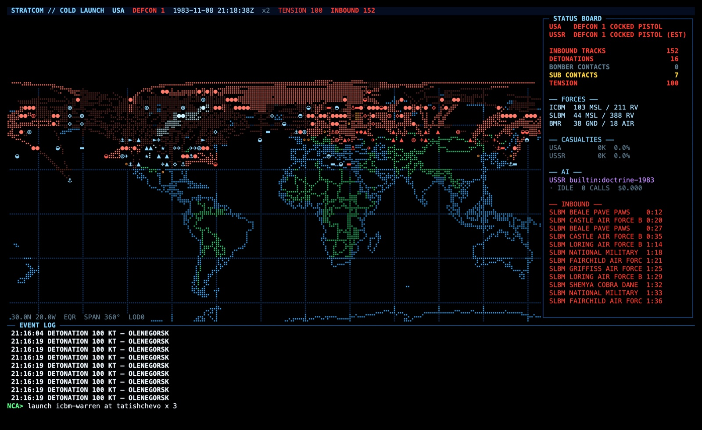
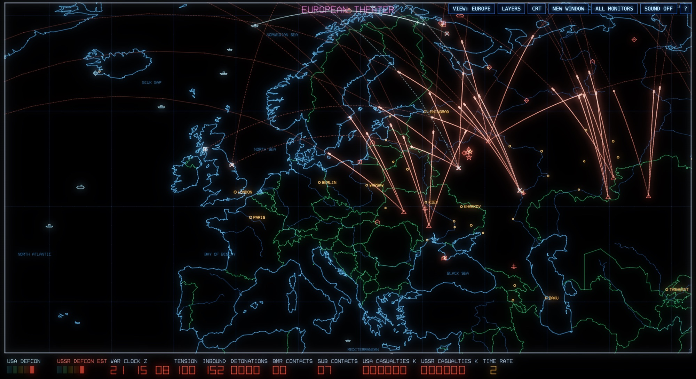
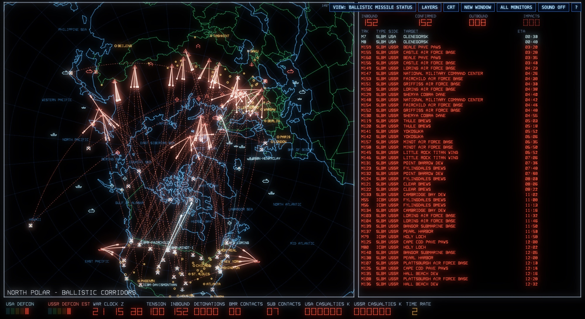
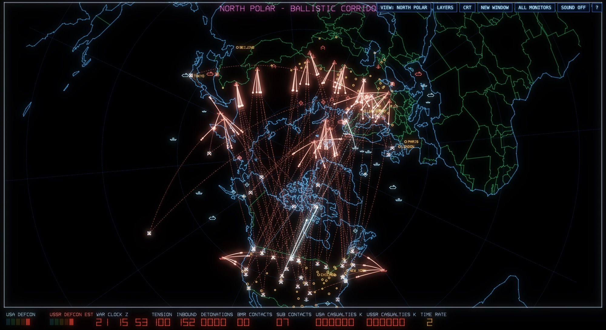
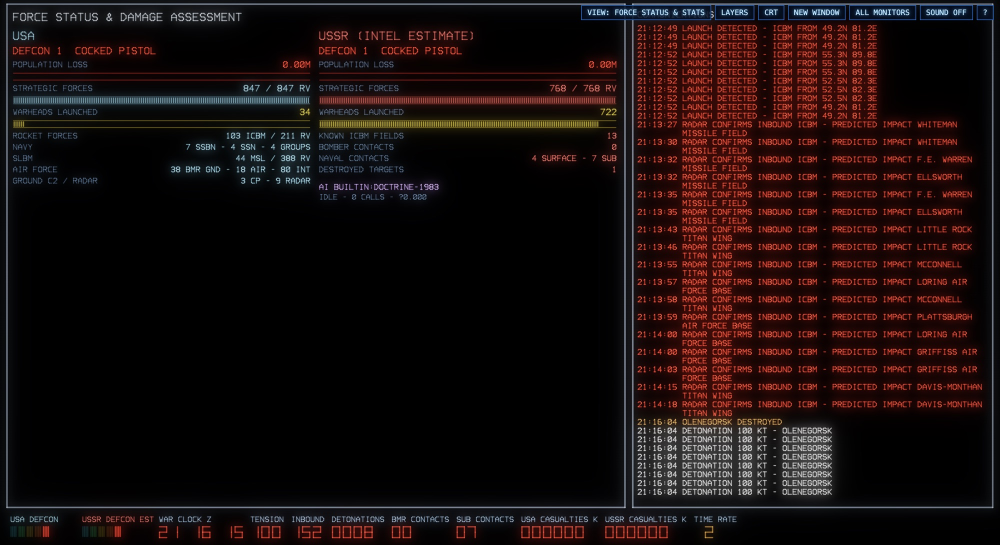

# STRATCOM // COLD LAUNCH

A real-time 1983 USA-vs-USSR strategic command game. You give orders from **your own terminal**. A glowing
**vector wall display** (Electron or any browser, on one monitor or several) shows the war room live. Your
opponent can be the built-in doctrine AI, **Gemini** or **Claude**, and AI coding tools can command your side through **MCP**.

The look is inspired by early-80s NORAD-style vector displays. The game, its name, its text and its endings are original.


<p align="center"><em>The war-room wall preset: theater maps, base close-ups, comms log, ballistic missile warning board and indicator strip.</em></p>

| Terminal console | European theater |
|---|---|
|  |  |
| **Ballistic missile warning** | **North polar corridors** |
|  |  |
| **Force status & damage assessment** | |
|  | |

```
 terminal console (braille vector map, orders) ─┐
 Electron / browser wall display(s) ────────────┼── ws://127.0.0.1:7700 ── game engine (authoritative, fog of war)
 Claude Code / Gemini CLI via MCP ──────────────┘                              └── AI opponent (rules · Gemini · Claude)
```

## Quick start

Requires Node.js 22 or newer.

```bash
git clone https://github.com/nanobiolog/wargames.git && cd wargames
npm install
npm run gui:build      # build the wall display once
npm run setup          # optional: add Gemini / Claude API keys (see below)
npm start              # engine + terminal console + wall display
```

Without any API key you play against the built-in doctrine AI.

### Add an AI opponent (API keys)

Run **`npm run setup`**. It asks for your keys with hidden input and saves them to `~/.coldlaunch/config.json`
(readable only by you). It also lets you pick your default opponent, its temperament and the display mode.

| provider | where to get a key | |
|---|---|---|
| Gemini | [aistudio.google.com/apikey](https://aistudio.google.com/apikey) | paste it into `npm run setup`, or `export GEMINI_API_KEY=...` |
| Claude | Claude Console → API keys | paste it into `npm run setup`, or `export ANTHROPIC_API_KEY=...`, or just run `ant auth login` |

```bash
npm run setup -- --show          # see what's configured (keys masked)
npm run setup -- --clear-keys    # remove saved keys
npm run ai:smoke -- --provider gemini   # check a key works (one small, billed call)
```

Environment variables take priority over the config file. Keys are only sent to their own provider. Inside the
game, type `keys` for a reminder.

### Display: Electron window or browser tab

```bash
npm start                         # Electron window (default)
npm run web                       # same game, wall display in a normal browser tab
npm start -- --display none       # terminal only; open the display later
```

Save your preferred mode with `npm run setup`. In the terminal, `gui` reopens the display, and `web` opens a browser
tab at any time (`web conus`, `web missiles`, `web stats` …). If Electron isn't available, the game falls back to a browser tab.

Common variations:

```bash
npm start -- --opponent gemini:gemini-4-hydrogen    # Gemini opponent
npm start -- --opponent claude:claude-opus-5-5      # Claude opponent
npm start -- --side USSR --personality 0.9          # play the Soviet side against a hawkish US AI
npm start -- --all-monitors                         # Electron: one fullscreen window per monitor
npm start -- --ai-vs-ai --opponent gemini           # watch two AIs (spectator)
npm run sim -- --seed 3                             # headless rules-vs-rules match
```

### AI providers

| spec | notes |
|---|---|
| `rules` | built-in 1983 doctrine AI, no key needed (the default, and the fallback when an API call fails) |
| `gemini[:model]` | default `gemini-4-hydrogen`; also e.g. `gemini-3.5-flash`, `gemini-3.1-flash-lite`. Needs `GEMINI_API_KEY` |
| `claude[:model]` | default `claude-opus-5-5`; also `claude-sonnet-5-5`, `claude-haiku-5-5`. Uses `ANTHROPIC_API_KEY` or your `ant auth login` profile. Refusal fallback is enabled on Opus/Sonnet |
| `openai:model@baseURL` | any OpenAI-compatible endpoint (Ollama, LM Studio, OpenRouter …) |

`--advisor <spec>` picks the model that turns your **natural-language orders** into commands. It defaults to the
opponent's provider, or to whichever API key is set.

## Playing from the terminal

```
defcon 3                          scramble afb-loring 4
launch icbm-minot at kozelsk x 3  strike bmr-loring-1 at moscow
move cvbg-midway to sea of japan  recall bmr-loring-1
hotline we are standing down      speed 30 · pause · resume
zoom grand forks · goto barents sea · polar · world · layer roads off · select icbm-warren · track ssbn-ohio
list silo · list enemy · focus · gui · web conus · keys · link · save game1 · load game1 · new · help
```

Anything that isn't a command goes to your AI advisor ("send the Midway group into the Sea of Japan and put the
bombers on alert"). It shows a plan and asks `EXECUTE? [y/N]`, and the wall display previews the plan as dashed yellow lines.

Keys: arrows pan (on an empty line) · `+`/`-` zoom · mouse wheel zooms at the cursor · drag pans · click selects ·
`[`/`]` change speed · space pauses · PgUp/PgDn scroll the log · Tab completes. Selecting or zooming in the
terminal flies the wall display there, and clicking a unit on the wall selects it in the terminal.

Rules in brief: DEFCON escalates one step per 90 game-seconds. Bombers launch at DEFCON 3, and missiles and
go-codes need DEFCON 1. Missiles can't be recalled. Satellite warnings can be false alarms, while radar-confirmed
tracks are real. Silos that are hit lose their unlaunched missiles. Submarines stay hidden until sonar finds them or they fire.
The best possible score is zero casualties.

## Wall display, web and multiple monitors

The game server also serves the display over HTTP. `npm start` prints a link like
`http://127.0.0.1:7700/?token=…&role=USA`. Add `&preset=<name>` to choose what each window shows:

| preset | shows |
|---|---|
| `wall` | the full war-room wall: Alaska, CONUS, north-polar corridors, USSR, comms, base close-ups, world, missile board, indicator strip |
| `conus` `europe` `eurasia` `alaska` `pacific` `atlantic` `polar` `world` | one big map |
| `missiles` | ballistic missile warning board plus polar track map |
| `stats` | force status by branch, damage assessment, AI status |
| `log` | communications / event log |

Open one window per monitor with the toolbar's **ALL MONITORS** button. Electron places them fullscreen
automatically, and Chrome does too if you allow window management. Keys `1`-`9`/`0` switch a window's preset.
`--host 0.0.0.0` lets tablets and other PCs on your LAN join; they still need the token.

Map controls: wheel zooms the panel under the cursor, drag pans, double-click maximises a panel, right-click opens
the order menu (launch, scramble, strike, recall, move, DEFCON), and Esc restores the layout. **LAYERS** (`L`) toggles
coastlines, borders, states, provinces, rivers, lakes, roads, urban areas, graticule, cities, towns, forces,
contacts, missiles, predicted impacts, tracks, detonations, radar, air-defence rings, routes and labels. It also
has **service-branch filters** for Navy, Air Force, Strategic Rocket Forces, and Ground C2 & radars. **CRT** (`C`)
tunes bloom, phosphor persistence, scanlines and exposure.

## Command your side from Claude Code / Gemini CLI (MCP)

`npm start` writes `~/.coldlaunch/session.json` (mode 600), and the MCP server picks the session up from there.

```bash
claude mcp add coldlaunch -- npx tsx /path/to/WARGAMES/packages/mcp/src/index.ts
```

For Gemini CLI, add this to `~/.gemini/settings.json`:

```json
{ "mcpServers": { "coldlaunch": { "command": "npx", "args": ["tsx", "/path/to/WARGAMES/packages/mcp/src/index.ts"] } } }
```

Tools: `get_situation`, `list_units`, `get_unit`, `set_defcon`, `launch_missiles`, `scramble_bombers`,
`bomber_strike`, `recall_bombers`, `move_unit`, `hotline_send`, `focus_map`, `set_speed`. Launches and go-codes
need `confirm: true`. Everything the tool does appears live in your terminal and on the wall.

## Project layout

```
packages/shared   types, protocol (zod), geodesy + projections, command parser, ws client
packages/data     Natural Earth build script → geo/lod{0,1,2}.json, places, land mask; 1983 order of battle
packages/engine   simulation (movement, ballistics, ABM, detection/fog, DEFCON, crisis events, scoring), ws + HTTP server
packages/ai       Claude / Gemini / OpenAI-compatible providers, doctrine AI, opponent driver, advisor
packages/tui      terminal renderer (braille vector map, panels, input)
packages/gui      Electron shell + WebGL2 renderer (instanced glowing lines, bloom, phosphor persistence)
packages/mcp      MCP stdio server
packages/cli      launcher (npm start) and headless simulator
```

`npm test` runs the engine and integration tests, and `npm run typecheck` type-checks everything. `npm run geo` rebuilds the map
data from Natural Earth (public domain).
