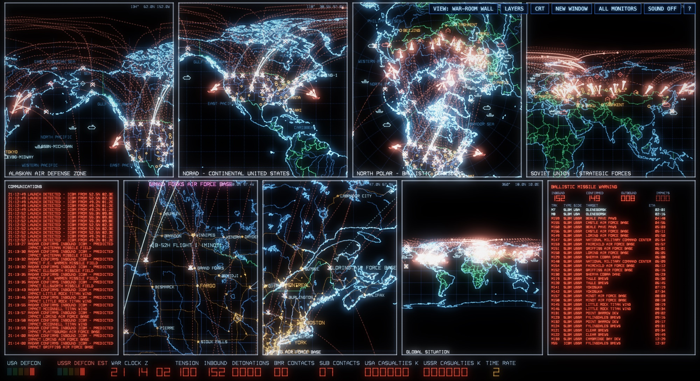
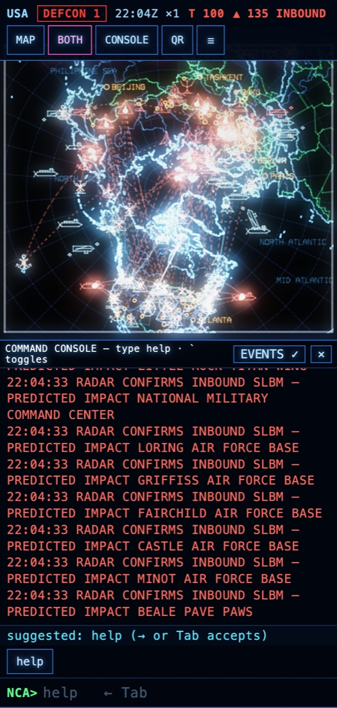

# STRATCOM // COLD LAUNCH

**▶ Play in your browser: [coldlaunch.nano-carbay.workers.dev](https://coldlaunch.nano-carbay.workers.dev)**: no install or sign-up. Pick a callsign, create a match and send the 5-letter code to a friend.

A real-time 1983 USA-vs-USSR strategic command game. You give orders from **your own terminal**, from the **browser**
or from your **phone**. A glowing **vector wall display** (Electron or any browser, on one monitor or several) shows the
war room live. Your opponent can be a friend online, the built-in doctrine AI, **Gemini** or **Claude**, and AI coding
tools can command your side through **MCP**.

| | |
|---|---|
| **Online matches** | Create a match, share the code (`K7M2Q`) or a QR code, invite friends by tag. Spectators get a TV view of everything |
| **Every screen you own** | Command the same side from your PC, a second monitor and your phone at once. Scan "my other screens" to link them |
| **Your AI key stays yours** | Bring your own Claude or Gemini key: it is stored only in your browser and goes straight to the provider |
| **Terminal first** | `npm start -- --join K7M2Q` joins an online match from any terminal, with type-ahead for every order |
| **Two scenarios** | **1983 Autumn Exercise** (USA vs USSR) and **2026 Straits Crisis**: five factions (USA, European coalition, Russia, China, India), alliances and a neutral that won't stay neutral if attacked. Up to 5 players, and the AI fills every empty seat |
| **Match rooms** | Creating a match opens a room: friends pick a nation and a **branch** (commander, navy, air force, rocket forces), so several players can run one country together. The host sets AI, speed and end rules, then presses START |
| **Wars that run their course** | By default a match never stops at the scenario's time limit or when the crisis calms down. Nations that lose everything, or resign, drop out and their players watch the rest |
| **Modern weapons & intelligence** | Reconnaissance satellites on real orbits, ISR drones and attack-drone swarms, low-flying cruise missiles, carrier recon / air patrols / strikes, surface battles and coastal radar. `intel` shows what your sensors see |

The look is inspired by early-80s NORAD-style vector displays. The game, its name, its text and its endings are original.


<p align="center"><em>The war-room wall preset: theater maps, base close-ups, comms log, ballistic missile warning board and indicator strip.</em></p>

| Terminal console | European theater |
|---|---|
|  |  |
| **Ballistic missile warning** | **North polar corridors** |
|  |  |
| **Force status & damage assessment** | **Phone: map + touch console** |
|  |  |

```
 terminal console (braille vector map, orders) ─┐
 Electron / browser wall display(s) ────────────┼── ws://127.0.0.1:7700 ── game engine (authoritative, fog of war)
 Claude Code / Gemini CLI via MCP ──────────────┘                              └── AI opponent (rules · Gemini · Claude)
```

## Quick start

Requires Node.js 22 or newer.

```bash
git clone https://github.com/nanobiolog/wargames.git && cd wargames
npm install
npm run gui:build      # build the wall display once
npm run setup          # optional: add Gemini / Claude API keys (see below)
npm start              # engine + terminal console + wall display
```

Without any API key you play against the built-in doctrine AI.

### Play online with friends (Cloudflare)

Each online match runs in its own Cloudflare Durable Object. It holds the authoritative engine, ticks while players are connected, and hibernates when the match is idle.

```bash
npm run cloud:dev       # local test server: http://127.0.0.1:8787
npm run cloud:deploy    # deploy to your Cloudflare account
```

**Live server:** https://coldlaunch.nano-carbay.workers.dev — `npm start -- --join K7M2Q` uses it by default.

Open the site and pick a **callsign**, or roll a random one. **Create a match** (vs a friend, the doctrine AI, or an LLM with your own key) and share the **5-character code** (e.g. `K7M2Q`) or the link `https://<host>/m/K7M2Q`. Friends add your **friend tag** and get live invites.

* **Several screens per player.** Open the same match on a second monitor, another tab or your phone. Screens with the same callsign identity command the same side.
* **Spectators** get the whole picture: `…/m/K7M2Q?role=SPECTATOR&preset=wall`.
* **Terminal:** run `npm start -- --join K7M2Q` (set `COLDLAUNCH_SERVER` or `"server"` in `~/.coldlaunch/config.json`).
* **Your AI key stays with you.** In the browser it is stored on your device only (Settings → AI keys), never sent to the game server. It goes straight to the provider. A phone without a key can still give plain-English orders: your PC tab or terminal that has the key makes the AI call.

Settings (graphics quality, frame-rate cap, resolution, reduce motion, callsign, AI keys) are in the toolbar. See [docs/ROADMAP.md](docs/ROADMAP.md) for the architecture, profiling results, the modern multi-country scenario plan, and monetisation and marketing.

### Add an AI opponent (API keys)

Run **`npm run setup`**. It asks for your keys with hidden input and saves them to `~/.coldlaunch/config.json`
(readable only by you). Then pick models from a numbered list, along with the opponent's temperament and the display mode.
Run **`npm run models`** any time to change just the models:

```
  Opponent AI   (price per 1M tokens: input / output)
   1) Built-in doctrine AI (offline)                   free
   2) Gemini 3.1 Flash-Lite — cheapest Gemini, fast    $0.25 / $1.50
   3) Gemini 4 Hydrogen — strongest Gemini listed      $1.50 / $7.50
   4) Gemini 3.5 Flash — general purpose               ~$1.50 / $9 (unconfirmed)
   5) Claude Haiku 5.5 — cheapest overall, fast        $0.10 / $0.50
   6) Claude Sonnet 5.5 — balanced                     $2 / $10
   7) Claude Opus 5.5 — strongest strategist           $4 / $20
  Choice [2]:
```

A game makes one opponent call every few game-minutes, plus one on each important event. Each call is about 3-4k
input tokens and well under 100 output tokens, so with Flash-Lite or Haiku a whole evening costs cents. Your
**advisor** (plain-English orders) can use the same model or a different one.

| provider | where to get a key | |
|---|---|---|
| Gemini | [aistudio.google.com/apikey](https://aistudio.google.com/apikey) | paste it into `npm run setup`, or `export GEMINI_API_KEY=...` |
| Claude | Claude Console → API keys | paste it into `npm run setup`, or `export ANTHROPIC_API_KEY=...`, or just run `ant auth login` |

```bash
npm run models                   # choose opponent / advisor models (numbered list)
npm run setup -- --show          # see what's configured (keys masked)
npm run setup -- --clear-keys    # remove saved keys
npm run ai:smoke                 # test your saved opponent model (one small, billed call)
```

Environment variables take priority over the config file. Keys are only sent to their own provider. Inside the
game, type `keys` for a reminder.

### Display: Electron window or browser tab

```bash
npm start                         # Electron window (default)
npm run web                       # same game, wall display in a normal browser tab
npm start -- --display none       # terminal only; open the display later
```

Save your preferred mode with `npm run setup`. In the terminal, `gui` reopens the display, and `web` opens a browser
tab at any time (`web conus`, `web missiles`, `web stats` …). If Electron isn't available, the game falls back to a browser tab.

### Scenarios

| scenario | factions | notes |
|---|---|---|
| `1983` (default) | USA vs USSR | the classic two-player crisis during a NATO command-post exercise |
| `modern` | USA + European coalition (allied) · Russia + China (aligned) · India (neutral) | a fictional 2026 stand-off over the sea lanes. Attacking a nation that is not already your enemy makes it one. Online: friends take seats, the doctrine AI plays the rest; locally, every other faction is an AI |

Online, pick the scenario and your faction in the lobby. Locally: `npm start -- --scenario modern --side CHN`.
Forces sit at publicly known, approximate locations and are scaled for play, not accuracy.

### Match rooms, branches and spectators

Online matches open in a **room** with the clock stopped. Everyone picks a nation and a branch in the room; nobody has
to rush, and late friends can still sit down. Branches split a nation's orders:

| branch | gives the orders for |
|---|---|
| commander | DEFCON, hotline, resigning, and every branch nobody else holds |
| navy | carriers, surface groups, submarines (including SLBM launches), carrier jets, ship cruise missiles |
| air force | bomber bases and bombers, fighter bases, land-based jets and drones |
| rocket forces | ICBM fields |

The server checks every order against the sender's branch. The **host** sets scenario, opponents, AI temperament,
speed and the ending rule in the room, then presses **START**. During the match the host can **END MATCH** for
everyone or set up a **NEW MATCH**. In the default open-ended mode, a nation that has lost all its missiles,
aircraft, ships and air bases is out, and so is one that types `resign`. Its players become **spectators**, and the match goes
on until one nation or one alliance is left. In the terminal: `seat CHN navy`, `seat watch`, `start`, `endmatch`.

### Air operations and intelligence

```
recon cvbg-midway to sea of okhotsk      # 2 jets search ~350 km around a point (any DEFCON)
cap cvbg-eisenhower                      # combat air patrol over the group (DEFCON 4; shoots at DEFCON 3)
airstrike cvbg-americas at sag-kirov x 10  # conventional raid on a ship group or base (DEFCON 2)
intel                                    # what radars, satellites and recon flights are tracking
hotline chn: we seek calm in the straits # in multi-faction games, address one nation
```

Satellites, drones and cruise missiles:

```
drone m-int-kadena to east china sea         # ISR drone circles for hours (any DEFCON; easy to shoot down)
drone m-ab-engels attack m-csg-qe x 20      # one-way attack-drone swarm at a ship group or base (DEFCON 2)
cruise m-csg-ford at m-sag-northern x 8     # conventional cruise missiles from a ship or attack sub (DEFCON 2)
```

Every nation has reconnaissance satellites on circular orbits. Their ground tracks move over the rotating Earth, and
ships under the swath are imaged. You can see everyone's satellites. Cruise missiles get no satellite launch warning,
and only radars, fighters and ships close to their track pick them up. Point defence can engage only a few per minute,
so a big salvo gets some through.

Jets come from the group's own fighters, so a carrier with its air wing away defends itself less. Recon flights
identify ships and aircraft and may catch a submarine near the surface. Surface groups that hold a contact on a hostile
group within 300 km trade anti-ship missiles at DEFCON 2. Coastal radars track ships, and every faction receives an
intelligence summary every 30 game-minutes.

Common variations:

```bash
npm start -- --opponent gemini                      # your saved Gemini model (default gemini-3.1-flash-lite)
npm start -- --opponent claude:claude-haiku-5-5     # a specific Claude model
npm start -- --opponent human --host 0.0.0.0        # a friend plays the other side from another PC
npm start -- --side USSR --personality 0.9          # play the Soviet side against a hawkish US AI
npm start -- --scenario modern --side EUR           # 2026: command the European coalition, AI plays the other four
npm start -- --all-monitors                         # Electron: one fullscreen window per monitor
npm start -- --ai-vs-ai --opponent gemini           # watch two AIs (spectator)
npm run sim -- --seed 3                             # headless rules-vs-rules match
npm run profile -- --games 3                        # time every engine phase, routing, snapshots and type-ahead
```

### AI providers

| spec | notes |
|---|---|
| `rules` | built-in 1983 doctrine AI, no key needed (the default, and the fallback when an API call fails) |
| `human` | no AI. A second person plays the other side (see [Multiple screens and multiple PCs](#multiple-screens-and-multiple-pcs)) |
| `gemini[:model]` | bare `gemini` uses the Gemini model you picked in setup (otherwise `gemini-3.1-flash-lite`). Needs `GEMINI_API_KEY` |
| `claude[:model]` | bare `claude` uses the Claude model you picked in setup (otherwise `claude-haiku-5-5`). Uses `ANTHROPIC_API_KEY` or your `ant auth login` profile. Refusal fallback is enabled on Opus/Sonnet |
| `openai:model@baseURL` | any OpenAI-compatible endpoint (Ollama, LM Studio, OpenRouter …) |

`--advisor <spec>` picks the model that turns your **natural-language orders** into commands. It defaults to the
opponent's provider, or to whichever API key is set.

## Playing from the terminal

```
defcon 3                          scramble afb-loring 4
launch icbm-minot at kozelsk x 3  strike bmr-loring-1 at moscow
move cvbg-midway to sea of japan  recall bmr-loring-1
hotline we are standing down      speed 30 · pause · resume
zoom grand forks · goto barents sea · polar · world · layer roads off · select icbm-warren · track ssbn-ohio
```

### Type-ahead: the console suggests as you type

You don't need to remember ids. As you type, the console:

- **completes the word** in grey (`launch icbm-w` → `arren`). Press **Tab** or **→** to accept, and **Tab** again to list the choices.
- **knows each argument**. After `launch` it offers *your* silos and submarines that still have missiles. After `at`
  it offers known enemy targets (missile fields first, then command posts, bases and cities). After `scramble` it
  offers bases that still have aircraft, and after `move … to` it offers sea areas and places. It never offers hidden enemy units.
- **shows the syntax** of the command you're typing on the hint line above the prompt, e.g.
  `launch <silo|ssbn> at <target> [x N] — fire ballistic missiles (irreversible)   [now: target]`.
- **suggests a next order** on an empty line, based on the situation. With inbound missiles it might offer
  `zoom grand forks missile field`; with unidentified contacts, `select unk-5663`; when tension is high, a de-escalating
  `hotline` message; once things calm down, a step back up to DEFCON 5. Tab accepts it.

Anything that isn't a command goes to your AI advisor ("send the Midway group into the Sea of Japan and put the
bombers on alert"). It shows a plan and asks `EXECUTE? [y/N]`, and the wall display previews the plan as dashed yellow lines.

Keys: arrows pan (on an empty line) · `+`/`-` zoom · mouse wheel zooms at the cursor · drag pans · click selects ·
`[`/`]` change speed · space pauses · PgUp/PgDn scroll the log · Tab/→ accept a suggestion · ↑/↓ history · Esc clears.
Selecting or zooming in the terminal flies the wall display there, and clicking a unit on the wall selects it in the terminal.

Rules in brief: DEFCON escalates one step per 90 game-seconds. Bombers launch at DEFCON 3, and missiles and
go-codes need DEFCON 1. Missiles can't be recalled. Satellite warnings can be false alarms, while radar-confirmed
tracks are real. Silos that are hit lose their unlaunched missiles. Submarines stay hidden until sonar finds them or they fire.
The best possible score is zero casualties.

### Command reference

Type `help` for this list in the game, or `help <command>` (e.g. `help launch`) for details and examples.
*Where* says whether a command works in the terminal, in the display's built-in console, or both.
This table is generated from the game's own command list (`npm run docs`).

<!-- commands:start -->

**Orders**

| command | what it does | example | where |
|---|---|---|---|
| `defcon &lt;1-5&gt;` | set your readiness level. DEFCON 5 is peacetime, 1 is maximum readiness. You can escalate only one level at a time, with about 90 game-seconds between steps. De-escalation is immediate. Bombers can take off at DEFCON 3 or lower; missile launches and bomber go-codes need DEFCON 1. The other side sees your change after an intelligence delay. | `defcon 4`<br>`defcon 5` | both |
| `launch &lt;silo\|ssbn&gt; at &lt;target&gt; [x N]`<br>alias: `fire` | fire ballistic missiles (irreversible). Fires N missiles (default 1) from one of your ICBM fields or ballistic-missile submarines. The target can be a known enemy unit id, an enemy city, or coordinates like 55.7,37.6. Liftoff happens after a short authentication delay. Missiles cannot be recalled. Firing from a submarine reveals its position. | `launch icbm-minot at kozelsk x 3`<br>`launch ssbn-ohio at 55.7,37.6` | both |
| `sortie &lt;carrier\|fighter base&gt; &lt;recon\|cap\|strike&gt; [to &lt;place\|target&gt;] [x N]`<br>alias: `recon`, `cap`, `airstrike` | fly jets from a carrier or fighter base: reconnaissance, air patrol or a strike. Draws aircraft from the carrier group's or base's fighters (which also defend it, so the group is weaker while they are away). RECON (any DEFCON, default 2 aircraft) flies to a point, searches ~350 km around it for 20 game-minutes, identifies ships, bombers and other flights, and reports. CAP, combat air patrol (DEFCON 4 or lower, default 4), orbits a point (default: over the carrier), shadows intruders and at DEFCON 3 shoots down hostile bombers and recon flights. STRIKE (DEFCON 2, default 8) is a conventional raid on a ship group or base; the target's air defence shoots some aircraft down. Flights come home when fuel runs low; recall brings them back early. Shortcuts: recon &lt;carrier&gt; to &lt;place&gt;, cap &lt;carrier&gt; [over &lt;place&gt;], airstrike &lt;carrier&gt; at &lt;target&gt;. | `recon cvbg-midway to sea of okhotsk`<br>`cap cvbg-eisenhower`<br>`airstrike cvbg-americas at sag-kirov x 10`<br>`sortie afb-elmendorf recon to bering sea` | both |
| `drone &lt;base&gt; to &lt;place&gt;  ·  drone &lt;base&gt; attack &lt;target&gt; [x N]`<br>alias: `swarm` | ISR drones that watch an area for hours, or one-way attack-drone swarms. ISR drone (any DEFCON): flies slowly to a point and circles it until its fuel runs low (many hours), identifying ships and aircraft within ~250 km. Cheap, unmanned and easy to shoot down: hostile air defence fires on it from DEFCON 4. Attack swarm (DEFCON 2): one-way loitering munitions flown at a ship group or base; most are shot down by its air defence, each survivor does a little damage. Only bases and carriers that carry drones (modern scenario) can launch them. | `drone m-int-kadena to east china sea`<br>`drone m-ab-engels attack m-csg-qe x 20` | both |
| `cruise &lt;surface group\|attack sub&gt; at &lt;target&gt; [x N]` | conventional cruise missiles at a military target. Fires N (default 4) subsonic, low-flying cruise missiles from a surface group or attack submarine at a ship group or base within range (1 200-1 600 km). They are not seen by satellites; only radars, fighters and ships close to their track pick them up, and air defence can shoot them down on the way. A ship target must still be near the aim point when they arrive. Firing reveals a submarine for a while. Requires DEFCON 2. | `cruise m-csg-ford at m-sag-northern x 8`<br>`cruise ssn-memphis at nb-severomorsk` | both |
| `resign`<br>alias: `concede` | stand down for good and watch the rest of the war. In open-ended matches your nation leaves the war: its forces stand down and you (and everyone on your side) become spectators. The match goes on for the others. | `resign` | both |
| `scramble &lt;base&gt; [N] [to &lt;place&gt;]` | launch bombers to a holding orbit. Sends N bombers (default: all) from a bomber base to a fail-safe orbit. Without "to", they fly to a default point toward the enemy. They wait there for a go-code (strike) and return home when fuel runs low; a tanker extends their time once. Requires DEFCON 3. | `scramble afb-loring`<br>`scramble afb-minot 3 to baffin bay` | both |
| `strike &lt;bomber-group&gt; at &lt;target&gt;`<br>alias: `go` | send the go-code to an airborne bomber group. The group flies to the target and releases all its weapons, then heads home if it has the fuel. Interceptors and carrier air defence can shoot bombers down on the way. Requires DEFCON 1. | `strike bmr-loring-1 at murmansk` | both |
| `recall &lt;bomber-group\|flight&gt;` | bring a bomber group home. Cancels an orbit or a strike that has not arrived yet; the aircraft return to base and can be scrambled again. | `recall bmr-loring-1` | both |
| `move &lt;unit&gt; to &lt;place&gt;` | move a fleet, submarine or bomber orbit. Carrier and surface groups and submarines route around land automatically and report when they are on station. For an airborne bomber group this sets a new orbit point. Fixed installations cannot move. | `move cvbg-midway to sea of japan`<br>`move ssn-memphis to barents sea` | both |
| `hotline &lt;message&gt;`<br>alias: `msg` | message the other side directly. Sends text over the direct communications link. AI opponents read and answer it. Conciliatory messages lower world tension a little (once every 5 game-minutes). | `hotline our bombers are on a training exercise. we propose a mutual stand-down.` | both |
| `ask &lt;anything&gt;` | natural-language orders via your AI advisor. Your advisor model turns plain language into orders and shows the plan for you to confirm (y/N). The wall display previews it as dashed yellow lines. Any line that is not a command is sent to the advisor automatically. | `ask put the bombers on alert and move the midway group north`<br>`what is the closest enemy submarine?` | both |

**Map**

| command | what it does | example | where |
|---|---|---|---|
| `zoom &lt;place\|in\|out\|N&gt;` | zoom the map (wheel and +/- work too). Zooms to a place, unit, city, sea area or lat,lon, or by a factor (in/out), or to an absolute zoom level N. The other screens follow when sync is on. | `zoom grand forks`<br>`zoom in`<br>`zoom 40` | both |
| `goto &lt;place&gt;`<br>alias: `center` | center the map without changing zoom | `goto barents sea` | both |
| `world` | reset to the whole world | `world` | both |
| `polar` | north-polar projection (missile corridors) | `polar` | terminal |
| `flat` | back to the flat projection | `flat` | terminal |
| `layer [name] [on\|off]`<br>alias: `layers` | list or toggle map layers. Without a name, lists all layers. The display also has service-branch layers: navy, air, rocket and ground. | `layer`<br>`layer roads off`<br>`layer navy off` | both |
| `view &lt;preset&gt;`<br>alias: `preset` | change what this display tab shows. Presets: wall, world, conus, europe, eurasia, alaska, pacific, atlantic, polar, missiles, stats, log. | `view missiles`<br>`view conus` | display |
| `select &lt;unit\|missile&gt;` | select a unit or missile track and show its details. Shows type, status, speed, distance remaining, ETA (game clock and real time), fuel and payload; for missiles: phase, altitude, speed, distance to impact and time to impact. Clicking a unit or a missile head on any map does the same. | `select cvbg-americas`<br>`select m12` | both |
| `track &lt;unit&gt;` | select a unit and keep the map centered on it. Esc stops tracking. | `track ssbn-ohio` | terminal |
| `focus` | fly the wall displays to the terminal view | `focus` | terminal |

**Info**

| command | what it does | example | where |
|---|---|---|---|
| `list [kind\|enemy]` | list your units or known enemy contacts. Kinds: silo, ssbn, ssn, carrier, airbase, bomber, afb_int, radar, abm, command, navalbase. | `list silo`<br>`list enemy` | both |
| `intel` | what your radars, satellites and recon flights are tracking. Every known contact grouped by type (surface groups, submarines, bombers, air flights, fixed sites), when it was last seen and whether it is identified, plus your own flights in the air. Radars track aircraft and ships near the coast, satellites pass every 20 minutes, and recon sorties identify everything within ~350 km. | `intel` | both |
| `info [unit\|missile]` | details of the selected (or named) unit or missile | `info`<br>`info bmr-loring-1` | both |
| `help [command]`<br>alias: `?` | list commands, or explain one in detail | `help`<br>`help launch` | both |
| `keys`<br>alias: `setup` | how to add Gemini / Claude API keys | `keys` | terminal |

**Session**

| command | what it does | example | where |
|---|---|---|---|
| `speed &lt;x&gt;` | set time compression. Game seconds per real second (0.5-120). Keys [ and ] step through 1, 2, 5, 10, 20, 30, 60. | `speed 30` | both |
| `pause` | pause the clock (space bar toggles). Everyone in the session sees the pause. | `pause` | both |
| `resume` | resume the clock | `resume` | both |
| `seat &lt;nation\|watch&gt; [commander\|navy\|air\|rocket]` | online matches: take a nation (and a branch), or watch. Before the start you can pick any free nation and branch; several players can share a nation, each commanding a branch (the commander covers branches nobody holds). During a match you can take over a nation the AI is playing, change branch, or watch. "seat watch" makes you a spectator. | `seat CHN`<br>`seat USA navy`<br>`seat watch` | both |
| `start` | online matches (host): start the clock. Matches open in a room with the clock stopped so everyone can take a seat. The host starts them. | `start` | both |
| `endmatch` | online matches (host): end the match for everyone. Open-ended matches keep going until one nation or alliance is left; the host can end them at any time. | `endmatch` | both |
| `share`<br>alias: `qr` | share this game with phones and other PCs (QR codes). Opens the game to your local network (no restart needed) and shows QR codes. Scan one with a phone to get the map plus a touch console, or open the links on another PC. Only the machine running the game can switch sharing on. Anyone with the link can join, so use it on trusted networks. | `share` | both |
| `link` | list the join links as text (no QR) | `link` | both |
| `gui` | open the wall display (your saved display mode) | `gui` | terminal |
| `web [preset]`<br>alias: `browser` | open a display in a new browser tab/window | `web conus`<br>`web missiles` | both |
| `save &lt;name&gt;` | save the game. Saved to ~/.coldlaunch/saves on the machine running the game. | `save crisis1` | both |
| `load &lt;name&gt;` | load a saved game | `load crisis1` | both |
| `new` | restart the scenario | `new` | both |
| `clear` | clear the console log | `clear` | both |
| `mouse on\|off` | mouse capture (off = terminal text selection) | `mouse off` | terminal |
| `bell on\|off` | beep on launch detection | `bell off` | terminal |
| `sync on\|off` | share selection and zoom with the other screens | `sync off` | both |
| `quit`<br>alias: `exit` | leave the game (stops the server if it runs here) | `quit` | terminal |

<!-- commands:end -->

## Wall display, web and multiple monitors

The game server also serves the display over HTTP. `npm start` prints a link like
`http://127.0.0.1:7700/?token=…&role=USA`. Add `&preset=<name>` to choose what each window shows:

| preset | shows |
|---|---|
| `wall` | the full war-room wall: Alaska, CONUS, north-polar corridors, USSR, comms, base close-ups, world, missile board, indicator strip |
| `conus` `europe` `eurasia` `alaska` `pacific` `atlantic` `polar` `world` | one big map |
| `missiles` | ballistic missile warning board plus polar track map |
| `stats` | force status by branch, damage assessment, AI status |
| `log` | communications / event log |

Keys `1`-`9`/`0` switch a window's preset, and the toolbar's **VIEW** menu does the same.

### Built-in console in every display tab

Press **`` ` ``** (backtick) or click **CONSOLE** in any display window or browser tab to open a command console
inside it. It accepts the same orders, help and type-ahead suggestions as the terminal, plus clickable suggestion chips and
display commands such as `view missiles`, `layer navy off`, `zoom europe` and `link`. You can play the whole game
from a browser without touching the terminal, for example on a second PC. Open it on load with `&console=1`.

Map controls: wheel zooms the panel under the cursor, drag pans, double-click maximises a panel, right-click opens
the order menu (launch, scramble, strike, recall, move, DEFCON), and Esc restores the layout. **LAYERS** (`L`) toggles
coastlines, borders, states, provinces, rivers, lakes, roads, urban areas, graticule, cities, towns, forces,
contacts, missiles, predicted impacts, tracks, detonations, radar, air-defence rings, routes and labels. It also
has **service-branch filters** for Navy, Air Force, Strategic Rocket Forces, and Ground C2 & radars. **CRT** (`C`)
tunes bloom, phosphor persistence, scanlines and exposure.

### Unit and missile details

Click any unit, task group or missile head on a map (or type `select <id>` / `info <id>`, e.g. `select m12`). The info
card shows live:

- **ships, subs and bomber groups:** status, speed (knots or km/h), heading, distance remaining along the planned route,
  and ETA on the game clock and in real time at the current time compression. Bombers add fuel, range left, holding
  endurance at the fail-safe point and their target.
- **missiles:** type and side, target, flight phase (boost, midcourse, terminal), altitude and apex, speed in km/s and
  Mach, distance to impact, time to impact, warheads × yield, and whether radar has confirmed the track.
- **bases and silos:** missiles and warheads left, aircraft, interceptors, radar range.
- **enemy contacts:** only what your intelligence has: identified or not, and when last seen.

### Map symbols

| symbol | unit | | symbol | unit |
|---|---|---|---|---|
| triangle with a missile | ICBM field | | runway with bomber | bomber base |
| delta-wing jet | interceptor base | | swept-wing bomber (turns to heading) | airborne bomber group |
| long hull, sail, missile deck | ballistic-missile submarine (SSBN) | | short hull with sail | attack submarine (SSN) |
| angled flight deck with escorts | carrier / surface task group | | anchor | naval base |
| dish on a mast | early-warning radar | | shield over a missile | ABM site |
| star in a ring | command post | | diamond with ? | unidentified contact |

Blue symbols are US forces, red are Soviet, yellow are unidentified, and magenta marks the selection. Ships and subs
face their direction of travel. The 1983 order of battle has no ground armies: the ground layer covers missile
fields, command bunkers and radars. Map labels use a vector font that draws accented letters (Ğ, Ş, İ, Ö, Ü, Ç, Å,
Ł, Vietnamese tone marks …) and transliterates Cyrillic and Greek.

## Multiple screens and multiple PCs

Every screen is just a client of the one game server. Screens can be windows on the same PC, browser tabs, or other computers.

**Several monitors on one PC**

1. Start the game: `npm start` (Electron) or `npm run web` (browser).
2. **Electron:** click **ALL MONITORS** (or press `Cmd/Ctrl+Shift+M`, or start with `--all-monitors`). You get one
   fullscreen window per monitor, in this order: wall, CONUS, missile board, stats, world, Europe, Eurasia, polar.
   Use the **VIEW** menu or keys `1`-`9` to change any of them.
3. **Browser:** click **ALL MONITORS** in Chrome or Edge and allow *window management* when asked. One window opens on each
   screen; press F11 in each for fullscreen. Without that permission, click **NEW WINDOW**, drag each window to a
   monitor, and choose its view, e.g. CONUS on one, *Ballistic missile status* on the next, then *Stats*, *World* and *Europe*.
   You can also open the links directly: `…&preset=conus`, `…&preset=missiles`, `…&preset=stats`, `…&preset=world`.

**Phones, tablets and other PCs: scan a QR code**

1. While the game is running, type **`share`** in the terminal, or click **SHARE** (**QR** on a phone) in any display.
   This opens the game to your local network with no restart needed, and shows QR codes:

   | QR code | opens |
   |---|---|
   | Phone: map + console | your side on a phone: polar map on top, touch console below |
   | Full war-room wall | your side's wall on a tablet, laptop or second PC |
   | Spectator wall | everything, for a TV or big screen (can only pause and change speed) |
   | Second player (phone) | the **other** side, for a friend (use with `--opponent human`) |

   In the terminal the QR code is drawn black-on-white so phone cameras can read it on a dark screen. Use ← → to
   switch codes and Esc to close. The display's share panel also lists every link with a COPY button, including the
   `npm start -- --join …` commands for someone who wants to play from their own terminal.
2. Scan with the phone camera on the same Wi-Fi. To share from the very start, use `npm start -- --lan`.

Only the computer running the game can switch sharing on. When it does, the server opens a second listener for
the LAN on the next port (e.g. 7701) and keeps the original one private. The token in the link is the only key to
the session, so share on networks you trust. Your OS may ask once whether Node may accept incoming connections.

**The phone layout** (the `phone` view, chosen automatically on small touch screens)

- A header shows your side, DEFCON, the war clock, tension and a blinking inbound counter, plus **MAP / BOTH / CONSOLE**
  tabs, a **QR** button and a **☰** menu.
- The map: drag to pan, pinch to zoom, tap a unit or missile for its details, long-press for the order menu.
- The console works like the terminal, with suggestion chips you can tap. Landscape puts the map and console side by side.

**Roles:** `role=USA` and `role=USSR` see only their own side's intelligence (fog of war) and can give orders.
`role=SPECTATOR` sees everything and can only pause or change speed, which suits a big TV wall. You can open as many
screens per role as you like, and they all stay in sync.

**Two human players:** start with `npm start -- --opponent human --lan` to turn off the AI. Your friend scans the
*Second player* QR code, or runs the `--join` command from the share list in their own terminal.

**Narrow terminals** (a phone SSH app, a split pane): the terminal console switches to a vertical layout, with the
map on top (north-polar view when the window is tall), a compact status board, the event log and the prompt.

## Command your side from Claude Code / Gemini CLI (MCP)

`npm start` writes `~/.coldlaunch/session.json` (mode 600), and the MCP server picks the session up from there.

```bash
claude mcp add coldlaunch -- npx tsx /path/to/WARGAMES/packages/mcp/src/index.ts
```

For Gemini CLI, add this to `~/.gemini/settings.json`:

```json
{ "mcpServers": { "coldlaunch": { "command": "npx", "args": ["tsx", "/path/to/WARGAMES/packages/mcp/src/index.ts"] } } }
```

Tools: `get_situation`, `list_units`, `get_unit`, `set_defcon`, `launch_missiles`, `scramble_bombers`,
`bomber_strike`, `recall_bombers`, `move_unit`, `hotline_send`, `focus_map`, `set_speed`. Launches and go-codes
need `confirm: true`. Everything the tool does appears live in your terminal and on the wall.

## Project layout

```
packages/shared   types, protocol (zod), geodesy + projections, command parser, ws client
packages/data     Natural Earth build script → geo/lod{0,1,2}.json, places, land mask; 1983 order of battle
packages/engine   simulation (movement, ballistics, ABM, detection/fog, DEFCON, crisis events, scoring), ws + HTTP server
packages/ai       Claude / Gemini / OpenAI-compatible providers, doctrine AI, opponent driver, advisor
packages/tui      terminal renderer (braille vector map, panels, input)
packages/gui      Electron shell + WebGL2 renderer (instanced glowing lines, bloom, phosphor persistence)
packages/mcp      MCP stdio server
packages/cli      launcher (npm start) and headless simulator
```

`npm test` runs the engine and integration tests, and `npm run typecheck` type-checks everything. `npm run geo` rebuilds the map
data from Natural Earth (public domain).
